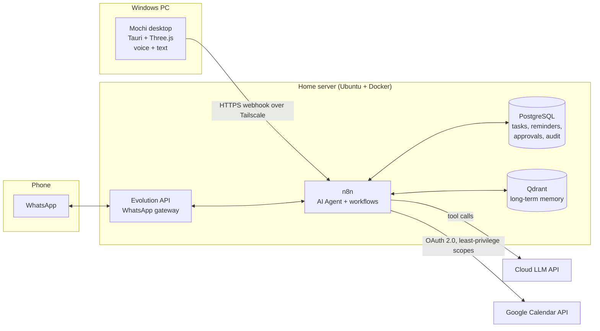

# Mochi — a self-hosted AI secretary with a 3D desktop mascot

> 🇧🇷 [Leia em Português](README.pt-BR.md)

Mochi is a personal AI secretary. A small 3D mascot sits on my Windows desktop,
and I can also reach it from WhatsApp. It manages my calendar, my tasks and my reminders.
The "brain" runs on a home server and talks to a cloud LLM. Any action that changes
something goes through an approval step before it runs.

**Status:** 🚧 In development — see the [roadmap](docs/roadmap.md) and the [devlog](docs/devlog/).

---

## Why

I wanted something between a chatbot and a real assistant:

- It **remembers** what I'm working on and what I owe to whom.
- It is **proactive**: a morning briefing, and warnings before deadlines, not only answers when I ask.
- It is **reachable anywhere**: on the desktop at home, on my phone outside, with no port open to the internet.
- It is **safe by default**: it reads freely, but it must ask before creating, changing or deleting anything.

It also helps me practice integration work end to end: LLM tool-calling, OAuth,
workflow automation, databases, private networking and a native desktop client.

## Architecture



More details are in [docs/architecture.md](docs/architecture.md).

## Features (planned → done)

| Area | Feature | Status |
|---|---|---|
| Access | Private access through Tailscale (no public ports) | ⏳ |
| Tasks | Create, list and complete tasks in natural language | ⏳ |
| Calendar | Read and create Google Calendar events | ⏳ |
| Reminders | Persistent scheduler, morning briefing, deadline warnings | ⏳ |
| Safety | Human-in-the-loop approval for every write action + audit log | ⏳ |
| Memory | Long-term memory of projects and preferences (Qdrant) | ⏳ |
| Channels | WhatsApp chat | ⏳ |
| Desktop | 3D mascot (Tauri + Three.js), transparent always-on-top window | ⏳ |
| Voice | Push-to-talk speech-to-text + text-to-speech | ⏳ |

## Tech stack

- **Orchestration:** n8n (AI Agent node, tools, schedule triggers)
- **LLM:** cloud API, provider-agnostic. The home server has no usable GPU or AVX, see [ADR-0001](docs/adr/0001-cloud-llm.md)
- **Data:** PostgreSQL 16 (structured data), Qdrant (vector memory)
- **Integrations:** Google Calendar API (OAuth 2.0), Evolution API (WhatsApp)
- **Network:** Tailscale (WireGuard mesh with ACLs)
- **Desktop:** Tauri 2 + Three.js, original low-poly mascot made in Blender (`.glb`)

## Repository layout

```
.
├── db/migrations/      SQL schema (tasks, reminders, approvals, audit log)
├── desktop/            Tauri + Three.js mascot client
├── docs/
│   ├── adr/            Architecture Decision Records
│   ├── setup/          Step-by-step setup guides
│   ├── devlog/         Build log (what I did, what I learned)
│   ├── architecture.md
│   ├── security.md
│   └── roadmap.md
├── n8n/workflows/      Exported workflows (sanitized, no credentials)
└── scripts/            Helper scripts (diagnostics, workflow sanitizer)
```

## Getting started

Follow the setup guides in order:

1. [Private network with Tailscale](docs/setup/01-tailscale.md)
2. [Database](docs/setup/02-database.md)
3. [Google Calendar OAuth](docs/setup/03-google-calendar.md)
4. [n8n agent](docs/setup/04-n8n-agent.md)

## Security

Read [docs/security.md](docs/security.md). In short: there are no public endpoints,
every service gets least-privilege credentials, secrets never go into git, and every
write action needs explicit approval and is logged.

## License

[MIT](LICENSE) © 2026 Guilherme Emannuel
