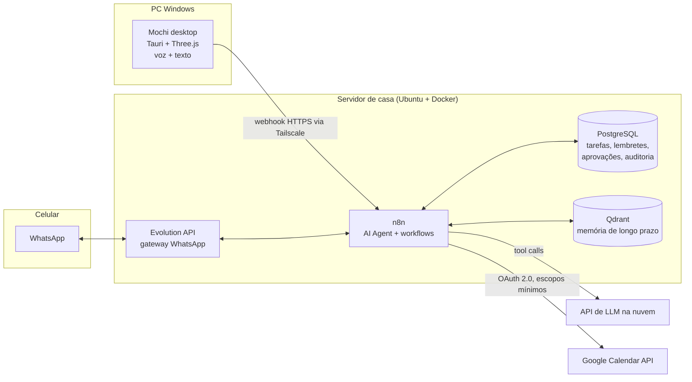

# Mochi — secretário de IA auto-hospedado com mascote 3D no desktop

> 🇺🇸 [Read in English](README.md)

O Mochi é um secretário pessoal com IA. Um pequeno mascote 3D fica na área de trabalho
do Windows, e também posso falar com ele pelo WhatsApp. Ele cuida da minha agenda,
das minhas tarefas e dos meus lembretes. O "cérebro" roda num servidor em casa e usa
uma IA na nuvem. Qualquer ação que altere algo passa por uma etapa de aprovação antes
de ser executada.

**Status:** 🚧 Em desenvolvimento — veja o [roadmap](docs/roadmap.md) e o [devlog](docs/devlog/).

> A documentação técnica detalhada (`docs/`) está em inglês. Este arquivo é o resumo em português.

---

## Por quê

Eu queria algo entre um chatbot e um assistente de verdade:

- Que **lembre** no que estou trabalhando e o que preciso entregar.
- Que seja **proativo**: resumo do dia pela manhã e aviso antes dos prazos, e não só respostas quando eu pergunto.
- Que eu **acesse de qualquer lugar**: no PC em casa e no celular na rua, sem abrir portas para a internet.
- Que seja **seguro por padrão**: lê à vontade, mas pede autorização antes de criar, alterar ou apagar qualquer coisa.

Também é uma forma de praticar integração de ponta a ponta: tool-calling com LLM, OAuth,
automação de workflows, banco de dados, rede privada e um cliente desktop nativo.

## Arquitetura

## Funcionalidades

| Área | Funcionalidade | Status |
|---|---|---|
| Acesso | Acesso privado via Tailscale (sem portas públicas) | ⏳ |
| Tarefas | Criar, listar e concluir tarefas em linguagem natural | ⏳ |
| Agenda | Ler e criar eventos no Google Calendar | ⏳ |
| Lembretes | Agendador persistente, resumo matinal, aviso de prazos | ⏳ |
| Segurança | Aprovação humana para toda ação de escrita + log de auditoria | ⏳ |
| Memória | Memória de longo prazo de projetos e preferências (Qdrant) | ⏳ |
| Canais | Conversa pelo WhatsApp | ⏳ |
| Desktop | Mascote 3D (Tauri + Three.js), janela transparente sempre visível | ⏳ |
| Voz | Fala-para-texto (apertar para falar) + texto-para-fala | ⏳ |

## Tecnologias

n8n · PostgreSQL 16 · Qdrant · Google Calendar API · Evolution API · Tailscale · Tauri 2 · Three.js · Blender

## Como começar

Siga os guias em ordem: [Tailscale](docs/setup/01-tailscale.md) →
[Banco de dados](docs/setup/02-database.md) →
[Google Calendar](docs/setup/03-google-calendar.md) →
[Agente n8n](docs/setup/04-n8n-agent.md).

## Licença

[MIT](LICENSE) © 2026 Guilherme Emannuel
