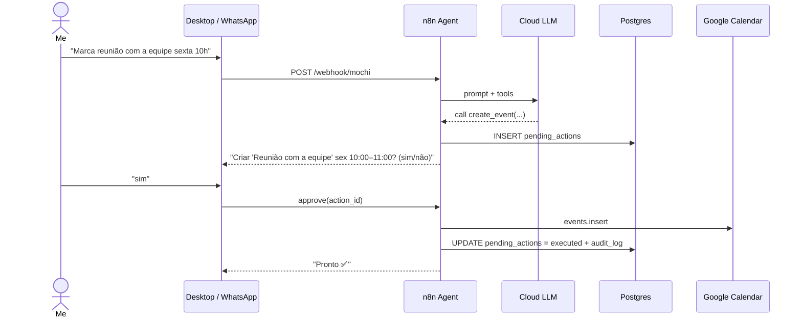
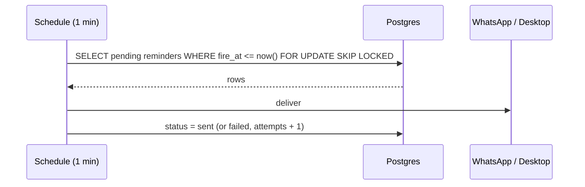

# Architecture

## Goals and constraints

| Goal | Constraint that shaped it |
|---|---|
| Always-available assistant | Runs on an existing home server that also hosts other apps, so it must not disturb them |
| Good reasoning quality | Server CPU (Intel i7-860, 2009) has no AVX, the GPU is unusable for ML and there is ~3.5 GB free RAM, so the LLM runs in the cloud ([ADR-0001](adr/0001-cloud-llm.md)) |
| Use from phone and outside home | No public ports, so access goes through Tailscale ([ADR-0003](adr/0003-tailscale.md)) |
| Safe automation | The LLM must never change data on its own, so writes go through an approval step ([ADR-0005](adr/0005-human-in-the-loop.md)) |
| Reminders that actually fire | They can't depend on the LLM "remembering", so reminders live in Postgres and a cron-like trigger fires them |

## Components

### 1. Desktop client — `desktop/`
Tauri 2 app with a transparent, frameless, always-on-top window that renders the mascot with
Three.js (`.glb` model with idle / listening / thinking / talking animations).

- Input: text box, or push-to-talk (global hotkey).
- Output: speech bubble plus optional TTS.
- It talks to **one** endpoint: `POST /webhook/mochi` on n8n, over Tailscale, with a bearer token.
- It holds no business logic, so the mascot can be swapped without touching the brain.

### 2. Orchestrator — n8n
Reuses the n8n instance already on the server ([ADR-0002](adr/0002-n8n-orchestrator.md)).

Workflows:

| Workflow | Trigger | Job |
|---|---|---|
| `mochi-chat` | Webhook (desktop) / Evolution API (WhatsApp) | Runs the AI Agent with tools and returns the reply |
| `mochi-reminders` | Schedule, every minute | Picks due reminders from Postgres and delivers them |
| `mochi-briefing` | Schedule, weekdays 07:00 | Builds the day summary (calendar + tasks) and sends it |
| `mochi-approvals` | Webhook / WhatsApp reply | Approves or rejects a pending action, then executes it |

### 3. Agent tools

Read tools run directly. Write tools only create a **pending action** that I must approve.

| Tool | Type | Backed by |
|---|---|---|
| `list_tasks` | read | Postgres |
| `list_events` | read | Google Calendar |
| `search_memory` | read | Qdrant |
| `create_task` / `complete_task` | write → approval | Postgres |
| `create_event` / `update_event` | write → approval | Google Calendar |
| `schedule_reminder` | write → approval | Postgres |
| `save_memory` | write (low risk, logged) | Qdrant |

### 4. Data — PostgreSQL (`mochi` database)
Schema in [`db/migrations`](../db/migrations). Tables:

- `tasks`: to-dos with priority, due date and status.
- `reminders`: what to say, when and on which channel, plus delivery status (for retries).
- `pending_actions`: the approval queue (tool, payload, human-readable summary, expiry).
- `audit_log`: append-only record of everything Mochi did.

### 5. Memory — Qdrant
A dedicated collection `mochi_memory` stores facts about projects and preferences.
Short-term chat history uses n8n's Postgres chat memory.

## Main flows

### Chat with approval

### Reminder delivery

## Resource budget (home server)

The target is under 300 MB of extra RAM. Mochi adds **no new long-running containers**
in phase 1. It uses the existing n8n, Postgres and Qdrant, plus a new database, a new
collection and new workflows.
